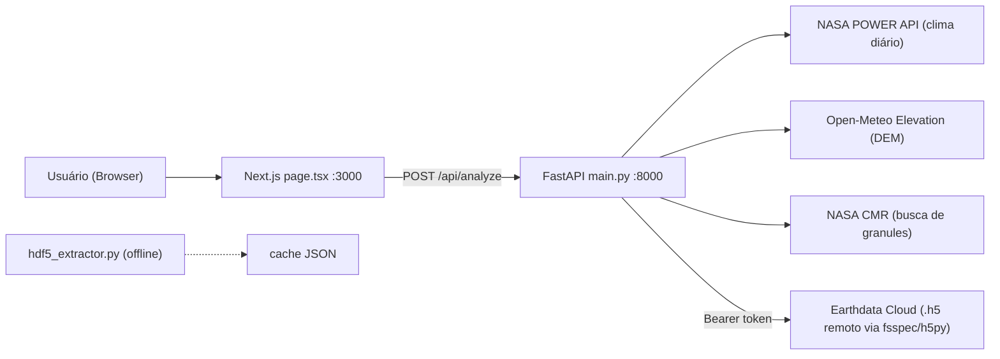
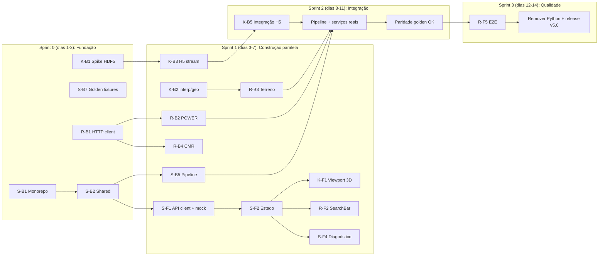

# PHASE-ZERO — Divisão de Tarefas (Migração 100% TypeScript)

> **Equipe:** Silvio · Ruan · Smolak
> **Objetivo:** Reescrever o backend (hoje Python/FastAPI) em **TypeScript (Node.js)** e refatorar o frontend (Next.js, hoje um único `page.tsx` de ~760 linhas com `any` em todo lugar) em componentes tipados, **mantendo paridade numérica** com a versão atual (v4.2).

---

## 1. Como o projeto funciona hoje

### 1.1 Visão geral



### 1.2 Backend (`backend/main.py`) — um único endpoint `POST /api/analyze`

| Etapa | Função atual | O que faz |
|---|---|---|
| 1. Resolver alvo | `run_phase_zero_pipeline` | Preset (`itaipu_normal`, `gongo_soco_active`, `maceio_subsidence`, `brumadinho_hist`) ou `custom` (lat/lon livre). Define nome, LOS vector, comprimento de onda. |
| 2. Clima | `fetch_live_nasa_power` | Busca TS, T2M, SW, PRECTOTCORR, RH2M, PS; descarta `-999`; amostra **16 datas** com `linspace`. Se falhar → **clima sintético** (senoides). |
| 3. Modelo ambiental | inline | `d_expected = 0.85·ΔTS + 0.03·ΔSW + 0.06·ΔPrecip`; `wet = 0.22·ΔRH`; `hydro = 1.8·ΔPS`; `tides = 2.8·cos(1.7t)`; `iono` senoidal (amplitude depende da banda L/C). |
| 4. Terreno | `build_3d_terrain_grid` | Grade 18×18. Preset → altitude base + relevo sintético. Custom → 25 pontos Open-Meteo, upsample 5→18 (`scipy.zoom order=2`); se plano (<6 m) mistura relevo sintético. |
| 5. Granules | `search_nasa_cmr_granules` | Busca no CMR (NISAR GUNW, OPERA DISP-S1, ARIA S1) links `.h5`/`.nc`. |
| 6. Stream HDF5 | `stream_real_nasa_h5_slice` | Só para `custom` + token > 20 chars: abre o último granule remoto, reprojeta lat/lon → EPSG do arquivo (`pyproj`), recorta janela 18×18 de fase/coerência (NISAR) ou deslocamento (OPERA). |
| 7. Pixels | loop 18×18 | Para cada pixel: zona (água/crista/talude/vegetação), coerência, série de anomalia "verdadeira", soma de todos os efeitos = **bruto**; subtrai efeitos conforme toggles = **compensado**; subtrai modelo NASA POWER = **residual**. Máscara por `min_coherence`; `anomaly_score = |residual_final| · γ`. |
| 8. Métricas | final | Pixel de referência `px_10_9`: **velocidade** (slope), **aceleração** (2ª derivada discreta), **score máximo**. |
| 9. Classificação | final | 🟢 `|vel|<0.35 && score<5` · 🟡 `|vel|<1.45 && |acel|<4.5 && score<20` · 🔴 caso contrário. |

`hdf5_extractor.py`: script offline que converte um GUNW NISAR local em JSON (fase→mm, iono, tropo e marés interpoladas com `RegularGridInterpolator`, coerência, componentes conectados).

### 1.3 Frontend (`frontend/app/page.tsx`)

Um único componente cliente com: header + seletor de cenários + modal de token Earthdata (localStorage) · barra de datas/lat/lon · **viewport 3D em `<canvas>`** (projeção manual, rotação azimute/pitch, clique para selecionar pixel) · painel de diagnóstico (status, 3 métricas, legenda de regras, 4 toggles, slider de coerência) · gráfico SVG de deconvolução temporal · gráfico SVG do loop termo-mecânico · rodapé com disclaimer.

### 1.4 Problemas identificados (serão resolvidos nas tarefas)

- `any` em todo o frontend, `strict: false` no `tsconfig`.
- `API_BASE` hardcoded (`http://localhost:8000`); sem estado de erro (se o backend cair, spinner infinito).
- `useEffect` com dependências incompletas; slider de coerência dispara uma requisição por movimento (sem debounce); requisições concorrentes sem cancelamento.
- Gráficos com escala Y fixa (±20 mm) — Brumadinho/Maceió podem estourar a área.
- Canvas com `18` e `8.5` hardcoded; sem suporte a `devicePixelRatio`.
- Lista de cenários duplicada (backend e frontend).
- `np.random.seed(42)` não é usado; `iono_uncertainty_mm` é constante.
- Launcher só para Windows (`start_phase_zero.bat`).
- Token Earthdata trafega no body e fica em `localStorage` (documentar o risco; nunca logar no backend).

---

## 2. Arquitetura alvo (TypeScript)

```
phase-zero-app/
├── package.json                # npm workspaces + scripts (dev, build, test, lint)
├── tsconfig.base.json          # strict: true
├── packages/
│   └── shared/                 # @phase-zero/shared
│       └── src/
│           ├── constants.ts    # λ NISAR/Sentinel, thresholds, disclaimer, GRID_SIZE
│           ├── schemas.ts      # Zod: AnalysisRequest / AnalysisResponse
│           └── types.ts        # tipos inferidos (z.infer)
├── backend/                    # Fastify + TypeScript
│   └── src/
│       ├── server.ts / app.ts / config.ts
│       ├── routes/             # analyze.ts, scenarios.ts, health.ts
│       ├── services/           # pipeline, classifier, nasaPower, terrain, cmr, h5Stream
│       ├── domain/presets.ts
│       ├── lib/                # math, interp, http, cache, geo
│       ├── scripts/extract-h5.ts
│       └── __tests__/ + fixtures/golden/*.json
└── frontend/                   # Next.js 14 + Tailwind
    └── app/ + components/ + hooks/ + lib/
```

### Equivalência de bibliotecas Python → TypeScript

| Python | TypeScript | Observação |
|---|---|---|
| FastAPI + Pydantic | **Fastify** + **Zod** (`fastify-type-provider-zod`) | Schemas compartilhados com o frontend |
| uvicorn `--reload` | `tsx watch` | |
| requests | `fetch` nativo (Node ≥ 20) + `AbortSignal.timeout` | |
| numpy | `lib/math.ts` próprio (arrays `number[]`) | Grade é só 18×18, não precisa de lib pesada |
| `scipy.ndimage.zoom(order=2)` | `lib/interp.ts` (spline quadrática ou bilinear) | Definir tolerância nos testes |
| `RegularGridInterpolator` | `lib/interp.ts` → `bilinear2D()` | |
| pyproj | **proj4** + definições UTM (EPSG 326xx/327xx) | |
| h5py + fsspec | **h5wasm** (ou alternativa decidida no spike K-B1) | Ponto de maior risco técnico |
| pytest | **Vitest** | Backend, shared e frontend |

### Contrato de API (fonte da verdade: `packages/shared`)

```ts
// packages/shared/src/schemas.ts (resumo)
export const AnalysisRequestSchema = z.object({
  scenario_id: z.string().default("gongo_soco_active"),
  apply_ionosphere: z.boolean().default(true),
  apply_troposphere: z.boolean().default(true),
  apply_solid_tides: z.boolean().default(true),
  apply_nasa_power: z.boolean().default(true),
  min_coherence: z.number().min(0).max(1).default(0.4),
  start_date: z.string().regex(/^\d{4}-\d{2}-\d{2}$/).default("2026-03-01"),
  end_date: z.string().regex(/^\d{4}-\d{2}-\d{2}$/).default("2026-09-15"),
  custom_lat: z.number().min(-90).max(90).nullish(),
  custom_lon: z.number().min(-180).max(180).nullish(),
  custom_name: z.string().max(120).nullish(),
  earthdata_token: z.string().nullish(),
});

export type StatusCode = "GREEN" | "YELLOW" | "RED";

export interface ThermoLoopPoint { date: string; surface_temp_c: number; displacement_mm: number; residual_mm: number; }
export interface PixelTimeSeries {
  observed_raw_mm: number[]; observed_compensated_mm: number[];
  expected_environmental_mm: number[]; residual_anomaly_mm: number[];
  thermo_loop: ThermoLoopPoint[];
}
export interface GridPixel {
  id: string; row: number; col: number; zone: string; lat: number; lon: number;
  elevation_m: number; coherence: number; compensated_los_mm: number; residual_mm: number;
  masked: boolean; anomaly_score: number; iono_uncertainty_mm: number;
  pixel_time_series: PixelTimeSeries;
}
export interface LosVector { losUnitVectorX: number; losUnitVectorY: number; incidenceAngle: number; elevationAngle: number; }
export interface AnalysisResponse {
  scenario_meta: {
    name: string; sensor: string; lat: number; lon: number; los_vector: LosVector;
    regime_info: string; power_real_ok: boolean; cmr_granules_count: number;
    h5_streamed_ok: boolean; asf_status: { latest_granule: string };
  };
  status: {
    code: StatusCode; label: string; description: string;
    residual_trend_mm_per_pass: number; acceleration_index_mm: number;
    max_weighted_anomaly_score: number;
  };
  dates: string[];
  grid_pixels: GridPixel[];
  disclaimer: string;
}
```

> [!IMPORTANT]
> O formato JSON de resposta **não muda** (snake_case mantido). Assim o frontend pode ser refatorado em paralelo usando os **fixtures golden** gerados a partir do backend Python atual.

---

## 3. Visão geral da divisão

Cada pessoa é dona de uma **fatia vertical** (backend + frontend do mesmo domínio), o que reduz conflitos de merge e dependências cruzadas.

| Pessoa | Domínio | Backend | Frontend |
|---|---|---|---|
| **Silvio** | Fundação, contratos e motor de análise | Monorepo, `shared`, servidor Fastify, `lib/math`, pipeline de compensação, métricas/classificação, testes de paridade, CI | Cliente de API tipado, hook de estado, layout da página, painel de diagnóstico, toggles, slider, estados de erro/loading |
| **Ruan** | Integrações externas e entrada do usuário | HTTP client, NASA POWER + fallback, terreno/DEM, CMR, presets + `/api/scenarios`, cache | Header, seletor de cenários, barra de datas/lat-lon com validação, modal de token, badges de fontes de dados, testes E2E |
| **Smolak** | Dados SAR/HDF5 e visualização | Spike HDF5, `lib/geo` (proj4), `lib/interp`, stream HDF5 remoto, CLI extratora | Viewport 3D (canvas), barra de info do pixel, gráfico de deconvolução temporal, loop termo-mecânico, escala de cores |

---

## 4. Tarefas detalhadas

Legenda de tamanho: **P** (≤ 0,5 dia) · **M** (1–2 dias) · **G** (3+ dias)

### 🟦 SILVIO

#### Backend

| ID | Tarefa | Tam. | Depende de |
|---|---|---|---|
| **S-B1** | **Monorepo e tooling.** npm workspaces (`packages/shared`, `backend`, `frontend`); `tsconfig.base.json` com `strict: true`; ESLint + Prettier; Vitest; scripts raiz `dev` (com `concurrently`, substitui o `.bat` e funciona em Mac/Linux/Windows), `build`, `test`, `lint`, `typecheck`. `.env.example` para backend e frontend. | M | — |
| **S-B2** | **Pacote `@phase-zero/shared`.** `constants.ts` (λ 238.4 / 55.5, `GRID_SIZE=18`, `PIXEL_STEP_DEG=0.00072`, thresholds de classificação, `OFFICIAL_DISCLAIMER`), `schemas.ts` (Zod de request/response conforme seção 2), `types.ts`. Exportar tudo de `index.ts`. | M | S-B1 |
| **S-B3** | **Servidor Fastify.** `app.ts` (factory testável), `server.ts`, `config.ts` (PORT, CORS_ORIGIN via env, validado com Zod), `@fastify/cors`, type provider Zod, `POST /api/analyze` (valida body, chama pipeline), `GET /api/health`, error handler padronizado `{ error, message }`, logger pino **com redact de `earthdata_token`**. | M | S-B2 |
| **S-B4** | **`lib/math.ts`.** `linspace`, `linspaceInt` (equivalente a `np.linspace(..., dtype=int)` → truncamento), `mean`, `round2` (atenção: `np.round` usa *banker's rounding*; documentar/testar diferença), `clip`, `nanToNum`, `argminAbs`, `arange`, `zeros`. 100% de cobertura. | P | S-B1 |
| **S-B5** | **`services/pipeline.ts` — motor de compensação.** Portar `run_phase_zero_pipeline`: resolução do alvo (preset/custom), modelo ambiental (`d_expected`, `wet`, `hydro`, `tides`), `iono` por ramo (stream / custom / preset), zonas do preset (água/crista/talude/vegetação com `sw_w`), série de anomalia com `rate`/`accel` a partir de `t>3`, soma bruto → compensado (toggles) → residual, máscara de coerência, `anomaly_score`, `iono_uncertainty_mm`. Receber serviços externos por **injeção de dependência** (`{ power, terrain, cmr, h5 }`) para testar com mocks. | G | S-B2, S-B4 (usa interfaces de R-B2..R-B4 e K-B3) |
| **S-B6** | **`services/classifier.ts`.** Funções puras: `computeSlope`, `computeAcceleration`, `maxScore`, `classify(slope, accel, score) → { code, label, description }`. Testes de **fronteira** (0.35, 1.45, 4.5, 5.0, 20.0) e dos 4 presets (Itaipu 🟢, Gongo Soco 🟡, Maceió 🔴, Brumadinho 🔴). | P | S-B2 |
| **S-B7** | **Fixtures golden + testes de paridade.** Script Python (`scripts/dump_golden.py`, roda uma única vez) que chama o pipeline atual com NASA POWER/CMR/Open-Meteo **mockados** e salva JSON para os 4 presets × combinações de toggles. Testes Vitest comparando a saída TS com tolerância `±0.01`. **Entregar os fixtures no dia 1–2: o frontend inteiro usa como mock.** | M | S-B1 |
| **S-B8** | **CI (GitHub Actions)** com `lint`, `typecheck`, `test`, `build` em todo PR. | P | S-B1 |

#### Frontend

| ID | Tarefa | Tam. | Depende de |
|---|---|---|---|
| **S-F1** | **`lib/api.ts` — cliente tipado.** `analyze(req): Promise<AnalysisResponse>` validando a resposta com Zod; `getScenarios()`; base URL via `NEXT_PUBLIC_API_URL`; `AbortController` cancelando a requisição anterior; erros tipados (`NetworkError`, `ValidationError`). Modo mock (`NEXT_PUBLIC_USE_MOCK=1`) lendo os fixtures golden. | M | S-B2, S-B7 |
| **S-F2** | **`hooks/useAnalysis.ts` — estado global.** Context (ou Zustand) com params, `data`, `selectedPixel`, `loading`, `error`; ações `setParam`, `selectScenario`, `runCustom`, `selectPixel`; preservar pixel selecionado entre análises (padrão `px_10_9`); **debounce de 300 ms** no slider de coerência; dependências do `useEffect` corretas. | M | S-F1 |
| **S-F3** | **Layout da página.** Reduzir `app/page.tsx` a composição de componentes; `tsconfig` do frontend com `strict: true`; remover todos os `any`. | P | S-F2 |
| **S-F4** | **Painel de diagnóstico.** Componentes `StatusCard`, `MetricsGrid` (3 métricas), `ThresholdLegend` (lendo thresholds de `shared/constants`), `CompensationToggles` (4 toggles), `CoherenceSlider`. | M | S-F2 |
| **S-F5** | **Estados de loading/erro.** Skeletons, banner de "backend offline" com botão "tentar novamente", indicador de reprocessamento sem esconder os dados antigos. | P | S-F2 |

---

### 🟩 RUAN

#### Backend

| ID | Tarefa | Tam. | Depende de |
|---|---|---|---|
| **R-B1** | **`lib/http.ts`.** `fetchJson<T>(url, { timeoutMs, retries, headers })` com `AbortSignal.timeout`, retry com backoff para 5xx/timeout, erros tipados (`HttpError`, `TimeoutError`). | P | S-B1 |
| **R-B2** | **`services/nasaPower.ts`.** Portar `fetch_live_nasa_power`: montar URL, filtrar `-999` em TS, exigir ≥ 4 dias válidos, amostrar 16 com `linspaceInt`, defaults (SW=200, PR=0, RH=65, PS=95). Portar também o **fallback sintético** (`syntheticClimate(start, end)`) incluindo a correção de datas inválidas (`end ≤ start → +180 dias`). Retornar `{ climate, isReal }`. Timeout 10 s. | M | R-B1, S-B4 |
| **R-B3** | **`services/terrain.ts`.** Portar `build_3d_terrain_grid`: relevo sintético (crista gaussiana + rampa + seno), altitude base dos presets (195 / 18 / 820), consulta Open-Meteo de 25 pontos, upsample 5×5 → 18×18 (usa `lib/interp.ts` do Smolak), regra "plano < 6 m", fallback `500 + relevo`. Timeout 5 s. | M | R-B1, K-B2 (interp) |
| **R-B4** | **`services/cmr.ts`.** Portar `search_nasa_cmr_granules` (4 short names, `page_size=20`, `sort_key=start_date`, filtro de links `https` `.h5/.nc` não-OPeNDAP). Retorna `Granule[]`; em erro retorna `[]` e loga warning. Timeout 8 s. | P | R-B1 |
| **R-B5** | **`domain/presets.ts` + `GET /api/scenarios`.** Mover `PRESET_EXAMPLES` para TS tipado (`Preset`), incluindo label com emoji e **datas padrão** de cada cenário (hoje só no frontend). Endpoint retorna lista para o seletor. | P | S-B3 |
| **R-B6** | **`lib/cache.ts`.** Cache LRU em memória com TTL (POWER: 6 h, DEM: 24 h, CMR: 1 h), chave `serviço:lat:lon:start:end`. Evita bater na NASA a cada movimento de slider. | P | R-B2..R-B4 |
| **R-B7** | **Testes dos serviços externos** com `fetch` mockado (`vi.fn`/`msw`): sucesso, `-999`, poucos dados, timeout, 500, payload inválido. | M | R-B2..R-B4 |

#### Frontend

| ID | Tarefa | Tam. | Depende de |
|---|---|---|---|
| **R-F1** | **`Header` + `ScenarioSelector`.** Título, badge do Space Apps, badge de granules; botões de cenário carregados de `GET /api/scenarios` (fallback estático se offline), destacando o ativo e aplicando as datas padrão. | M | S-F2, R-B5 |
| **R-F2** | **`SearchBar`.** Datas início/fim, nome, lat/lon como inputs numéricos com validação (lat −90..90, lon −180..180, início < fim, mensagens inline), botões "Atualizar Período" e "Buscar Lat/Lon Live" (desabilitados se inválido ou carregando). Texto do "Fluxo de análise". | M | S-F2 |
| **R-F3** | **`TokenModal`.** Modal acessível (foco, `Esc`, `aria-*`) para o Bearer token Earthdata; mostrar/ocultar; botão "Remover token"; persistência em `localStorage` encapsulada em `lib/tokenStorage.ts`; aviso de segurança; validação mínima (> 20 chars, igual ao backend). | M | S-F2 |
| **R-F4** | **`DataSourceBadges`.** Exibir `power_real_ok` (clima real vs sintético), `cmr_granules_count`, `h5_streamed_ok` e `sensor` — hoje o usuário não sabe se os dados são reais ou simulados. | P | S-F2 |
| **R-F5** | **Testes E2E (Playwright)** com backend mockado: carregar página, trocar os 4 cenários e conferir a cor do status, busca custom, abrir/fechar modal de token. | M | S-F3, R-F1..R-F3 |

---

### 🟧 SMOLAK

#### Backend

| ID | Tarefa | Tam. | Depende de |
|---|---|---|---|
| **K-B1** | **Spike: leitura de HDF5 remoto em TypeScript** (fazer **primeiro**, é o maior risco). Avaliar: (a) **h5wasm** com download do granule para cache em disco e leitura por slice; (b) h5wasm/jsfive com *HTTP range requests* (lazy file); (c) serviço **NASA Harmony** de subsetting (recebe só a janela 18×18). Medir tempo, memória e tamanho baixado com um granule real. Entregar `docs/ADR-001-hdf5.md` com a decisão. | M | — |
| **K-B2** | **`lib/interp.ts` + `lib/geo.ts`.** `bilinear2D(gridY, gridX, values, points, fill=0)` (equivalente a `RegularGridInterpolator(bounds_error=False)`); `zoom2D(matrix, factor, order)` para o upsample do DEM; `lib/geo.ts` com **proj4**: `toProjected(lat, lon, epsg)` gerando definições UTM 326xx/327xx automaticamente. Testes contra valores calculados em Python. | M | S-B4 |
| **K-B3** | **`services/h5Stream.ts`.** Portar `stream_real_nasa_h5_slice` conforme o ADR: auth `Bearer`, detectar estrutura **NISAR GUNW** (`/science/LSAR/GUNW/...`, fase × `−λ/4π`) ou **OPERA DISP** (`displacement` m → mm, `temporal_coherence`), reprojeção, cálculo de `r0/c0` com clamp de borda, `nanToNum` e `clip(0.05, 0.99)` na coerência. Timeout e limite de tamanho; erros nunca expõem o token. | G | K-B1, K-B2 |
| **K-B4** | **CLI `scripts/extract-h5.ts`** (porta de `hdf5_extractor.py`): `npm run extract -- <entrada.h5> <saida.json>`; lê camadas HH, interpola tropo úmida + hidrostática e marés para a grade do interferograma com `bilinear2D`, calcula médias de LOS/incidência/elevação ignorando NaN. | M | K-B1, K-B2 |
| **K-B5** | **Integração do stream no pipeline** (par com Silvio em S-B5): ramo `h5_streamed_ok` (série linear até o valor real do pixel, `zone = "PIXEL REAL HDF5 (r,c)"`, label do sensor). Teste com arquivo HDF5 pequeno de fixture gerado localmente. | P | K-B3, S-B5 |

#### Frontend

| ID | Tarefa | Tam. | Depende de |
|---|---|---|---|
| **K-F1** | **`TerrainViewport3D`.** Extrair a matemática para `lib/projection3d.ts` (funções puras: `project3D`, `buildMesh`, `sortByDepth`, `hitTest`) com testes; componente `TerrainCanvas.tsx` com malha, nós coloridos, vetor LOS e textos; controles Girar/Inclinar/Reset; **suporte a `devicePixelRatio`** e resize; tamanho da grade derivado dos dados (sem `18`/`8.5` fixos). Bônus: arrastar com o mouse para girar. | G | S-F2 |
| **K-F2** | **`PixelInfoBar`.** Zona, coerência (confiável/mascarado), altitude, residual, lat/lon do pixel selecionado. | P | S-F2 |
| **K-F3** | **`TimeSeriesChart`.** Gráfico SVG (bruto, clima NASA POWER, residual colorido pelo status) com **eixo Y auto-escalado**, rótulos de data adaptativos, legenda e tooltip ao passar o mouse. Componentes base reutilizáveis (`ChartFrame`, `Axis`, `Polyline`). | M | S-F2 |
| **K-F4** | **`ThermoLoopChart`.** TS (°C) × deslocamento (mm) com eixos auto-escalados, último ponto destacado, tooltip com data. Reusa base do K-F3. | M | K-F3 |
| **K-F5** | **`lib/colors.ts`.** Escala de cores única (residual 3.5 / 18 mm, máscara água vs terreno, cor por status) usada por canvas, gráficos e painéis. | P | S-B2 |

---

## 5. Cronograma sugerido



| Sprint | Silvio | Ruan | Smolak |
|---|---|---|---|
| **0** | S-B1, S-B2, S-B7, S-B8 | R-B1, R-B5 | K-B1 (spike + ADR) |
| **1** | S-B4, S-B6, S-B5, S-F1, S-F2 | R-B2, R-B3, R-B4, R-F2, R-F3 | K-B2, K-B3, K-F1, K-F5 |
| **2** | S-B3, S-F3, S-F4, S-F5, integração do pipeline | R-B6, R-B7, R-F1, R-F4 | K-B4, K-B5, K-F2, K-F3, K-F4 |
| **3** | Paridade final, README, remoção do Python | R-F5 (E2E), bugs | Performance do canvas, bugs |

---

## 6. Pontos de integração (contratos entre pessoas)

| Interface | Dono | Consumidor | Assinatura |
|---|---|---|---|
| Tipos/schemas | Silvio | Todos | `@phase-zero/shared` |
| Clima | Ruan | Silvio (pipeline) | `getClimate(lat, lon, start, end, n=16): Promise<{ climate: Climate; isReal: boolean }>` |
| Terreno | Ruan | Silvio | `getTerrainGrid(lat, lon, size, isCustom): Promise<number[][]>` |
| Granules | Ruan | Silvio / Smolak | `searchGranules(lat, lon, start, end): Promise<Granule[]>` |
| Slice HDF5 | Smolak | Silvio | `streamH5Slice(url, token, lat, lon, size): Promise<{ rawMmGrid: number[][]; coherenceGrid: number[][]; wavelengthMm: number }>` |
| Interpolação | Smolak | Ruan (terreno) | `zoom2D`, `bilinear2D` |
| Estado do frontend | Silvio | Ruan / Smolak | `useAnalysis()` |
| Cores | Smolak | Silvio / Ruan | `lib/colors.ts` |

> [!TIP]
> Combinem as **interfaces acima no dia 1** e criem stubs. Assim ninguém fica bloqueado esperando a implementação real do outro.

---

## 7. Propriedade de arquivos (evitar conflitos)

| Caminho | Dono |
|---|---|
| `package.json` raiz, `tsconfig.base.json`, `.github/`, `packages/shared/**` | Silvio |
| `backend/src/{app,server,config}.ts`, `routes/analyze.ts`, `routes/health.ts`, `services/{pipeline,classifier}.ts`, `lib/math.ts`, `__tests__/parity/**` | Silvio |
| `backend/src/routes/scenarios.ts`, `domain/presets.ts`, `services/{nasaPower,terrain,cmr}.ts`, `lib/{http,cache}.ts` | Ruan |
| `backend/src/services/h5Stream.ts`, `lib/{interp,geo}.ts`, `scripts/extract-h5.ts`, `docs/ADR-*.md` | Smolak |
| `frontend/app/page.tsx`, `frontend/lib/api.ts`, `hooks/**`, `components/diagnostics/**` | Silvio |
| `frontend/components/{header,search,token,badges}/**`, `lib/tokenStorage.ts`, `e2e/**` | Ruan |
| `frontend/components/{viewport,charts}/**`, `lib/{projection3d,colors}.ts` | Smolak |

Alterações em arquivos de outro dono → PR com o dono como revisor obrigatório.

---

## 8. Convenções e Definition of Done

**Git:** branches `feat/<id>-<descricao>` (ex.: `feat/R-B2-nasa-power`), commits *Conventional Commits*, PR pequeno com 1 revisor (rodízio: Silvio → Ruan → Smolak → Silvio).

**Uma tarefa só está pronta quando:**
- [ ] `npm run typecheck` sem erros (`strict: true`, **zero `any`** explícito).
- [ ] `npm run lint` e `npm test` passando no CI.
- [ ] Testes unitários cobrindo a lógica nova (backend ≥ 80%; funções puras de cálculo 100%).
- [ ] Para código portado do Python: teste de paridade com tolerância `±0.01`.
- [ ] Nenhum segredo/token em log, commit ou mensagem de erro.
- [ ] Revisado e aprovado por outra pessoa do time.

**Critério de aceite da migração (v5.0):**
1. Os 4 presets retornam o **mesmo status** (🟢🟡🔴🔴) e métricas iguais (±0.01) ao Python.
2. Busca custom funciona com e sem token Earthdata, sem quebrar se NASA POWER/CMR/Open-Meteo estiverem fora do ar.
3. `npm run dev` na raiz sobe backend (:8000) e frontend (:3000) em Mac, Linux e Windows.
4. `backend/main.py`, `hdf5_extractor.py`, `requirements.txt` e `start_phase_zero.bat` removidos (o script de golden fica em `scripts/legacy/`).
